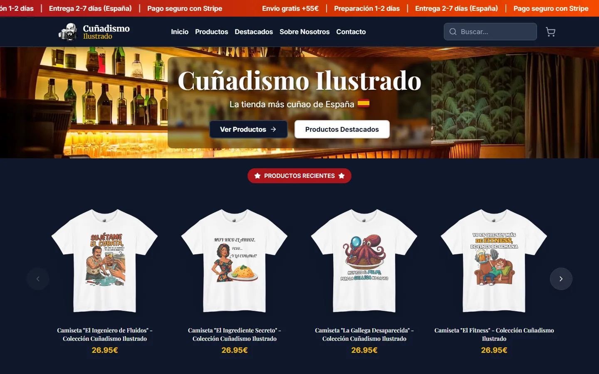
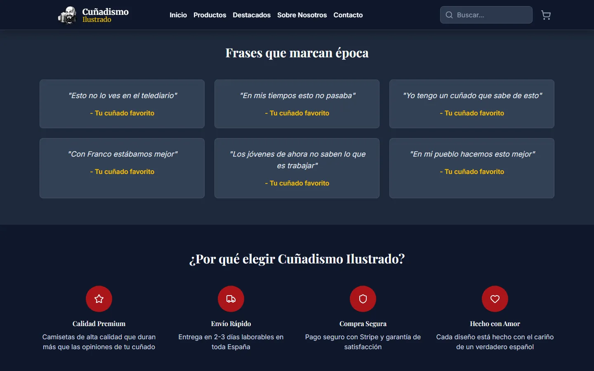
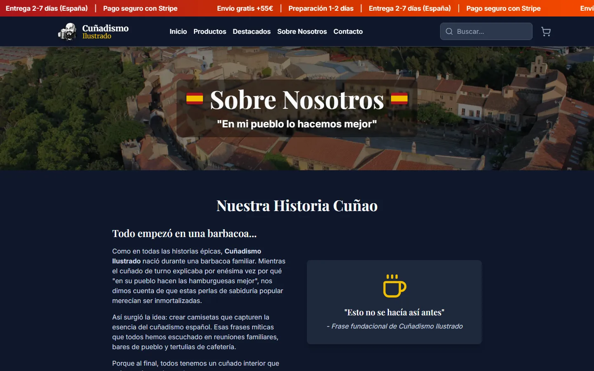
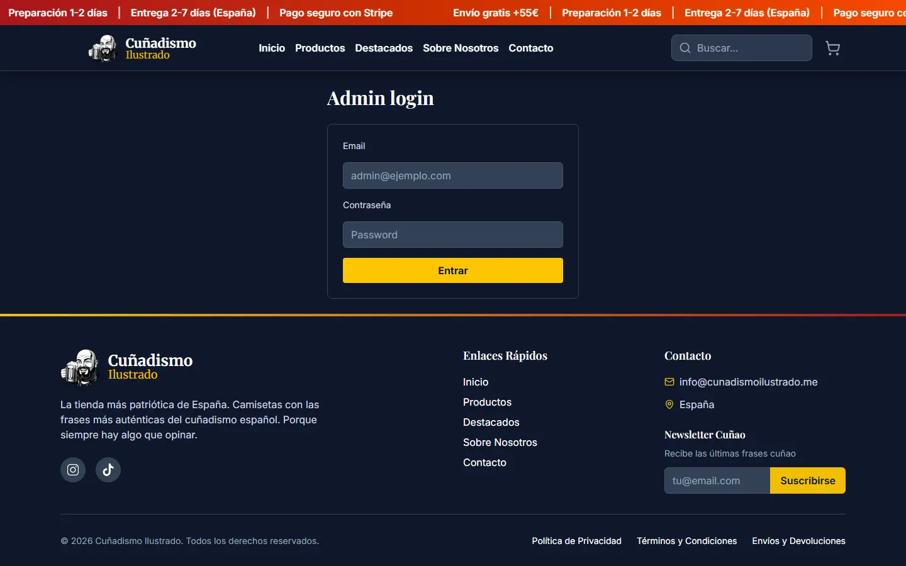

# Cuñadismo Ilustrado · Frontend

Storefront and admin panel for **Cuñadismo Ilustrado**, a small online shop selling Spanish-humour t-shirts and merch. Built and run solo, from design to production.



| Home | About | Admin login |
| --- | --- | --- |
|  |  |  |

> Screenshots were taken locally with the backend offline, so product listings are not shown.

## Status

The shop ran in production from August 2025 to mid 2026 and is now closed (the domain `cunadismoilustrado.me` has expired). It processed real orders through Stripe; the revenue is verified on TrustMRR:

<a href="https://trustmrr.com/startup/cunadismo-ilustrado"></a>

The repository is public for portfolio and review purposes only (see [License](#license)).

## Features

**Storefront**
- Product catalogue with search, featured products and recent products carousels. Products and variants come from the backend, which syncs them from Printify (print on demand).
- Product detail page with size/colour variants, image gallery and EU GPSR product safety information.
- Persistent cart (Zustand + `localStorage`) with a slide-over sidebar.
- Checkout with shipping zones (Spain / rest of Europe), discount codes and an optional marketing opt-in, then a redirect to **Stripe Checkout** created by the backend. Success and cancel pages.
- Customer reviews: post-purchase review form reached through a tokenized link, with photo upload, plus a reviews carousel.
- Newsletter signup (modal and footer) and a preferences page for subscribers.
- Contact form, legal pages (privacy, terms, shipping and returns), cookie banner with consent-gated Google Analytics 4.
- PWA: web manifest, icons and a service worker with an update prompt. SEO meta tags, `sitemap.xml` and `robots.txt`.

**Admin panel** (`/admin`, cookie session against the backend)
- Clients dashboard: customers, their orders and newsletter status, plus revenue, average order value, conversion and lifetime value stats by period.
- Reviews manager: moderate, publish or delete reviews (photos are stored on Cloudinary).
- Tag manager: edit product tags and sync them to Printify.
- Discount manager: create, edit and delete coupon codes; view newsletter subscribers.

## Tech stack

- React 19, TypeScript (strict), Vite 8
- Tailwind CSS 4, lucide-react icons, a few Material UI and Headless UI components
- React Router 7, Zustand 5, Axios, react-hot-toast
- Vitest 4 + Testing Library (jsdom)
- Deployed as a static build served with `serve` (Heroku `Procfile`)

The backend (Node.js, Express, TypeScript, Stripe webhooks, Printify, cron jobs) lives in [CodeInIA/cunao-backend](https://github.com/CodeInIA/cunao-backend).

## Project structure

```
src/
├── components/   # Header, Footer, cart sidebar, product cards, carousels, cookie banner
├── pages/        # Storefront routes (home, products, product detail, checkout, reviews, legal...)
│   └── admin/    # Admin login, dashboard and managers
├── services/     # Axios API clients (storefront and admin)
├── stores/       # Zustand stores (cart, products)
├── hooks/        # Analytics, image preloading, shipping config, local storage...
├── utils/        # Formatting, validation, consent, image helpers
├── types/        # Shared TypeScript types
└── __tests__/    # Vitest suites
public/           # Static assets, PWA manifest, service worker, icons
```

## Running locally

Requirements: Node.js 20.19+ or 22.12+ and npm. Most pages need the backend API running; without it the UI loads but product data is empty.

```bash
npm ci
cp .env.example .env   # then set VITE_API_URL and VITE_STRIPE_PUBLIC_KEY
npm run dev            # http://localhost:5173
```

All environment variables are documented in [`.env.example`](.env.example). Only `VITE_API_URL` matters for local development; the rest have defaults in `src/config.ts`.

| Script | Description |
| --- | --- |
| `npm run dev` | Vite dev server (proxies `/api` to the backend) |
| `npm run build` | Type check (`tsc -b`) and production build to `dist/` |
| `npm run preview` | Serve the production build locally |
| `npm test` | Vitest in watch mode (`npx vitest run` for a single run) |
| `npm run test:coverage` | Tests with V8 coverage |
| `npm run lint` | ESLint |

## Testing

29 tests across 5 suites, run with Vitest and Testing Library:

- **Cart store**: adding, removing and updating items, variants as separate lines, totals, cart visibility and the add-to-cart animation trigger.
- **Purchase flow (integration)**: browse, add to cart, update quantities and variants, totals with discounts.
- **Header and Footer**: rendering, navigation links, cart count, semantic structure.
- **Routing**: app renders and the home route resolves.

CI (GitHub Actions, `.github/workflows/ci.yml`) installs dependencies, runs lint (non-blocking), tests and the production build on Node 20 and 22.

## License

Copyright (c) 2025-2026 Sergio Barrios Paz. All rights reserved.

The source code is public for portfolio and review only. No license is granted to use, copy, modify or distribute the code, and the same applies to the designs, illustrations, product images and brand assets. See [LICENSE](LICENSE).
